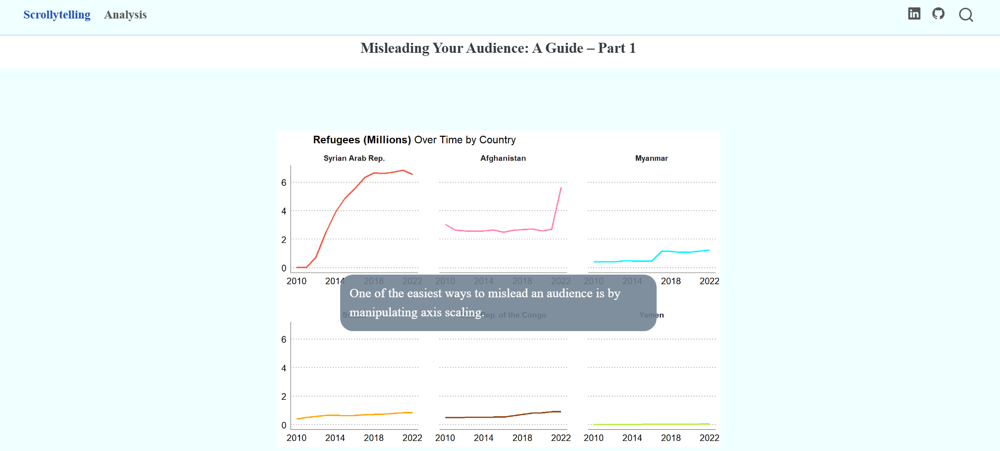

An interactive scrollytelling piece built with the Quarto [closeread](https://github.com/qmd-lab/closeread) extension exploring visual bias in data communication using UNHCR refugee data. This project demonstrates how y-axis scaling choices shape the interpretation of time-series trends.

[**View live**](https://01a1b77a-10ec-c5ab-c42d-e4b2f6faed11.share.connect.posit.cloud/) · [**Code**](https://github.com/darakhshannehal/Scrollytelling-Closeread)

