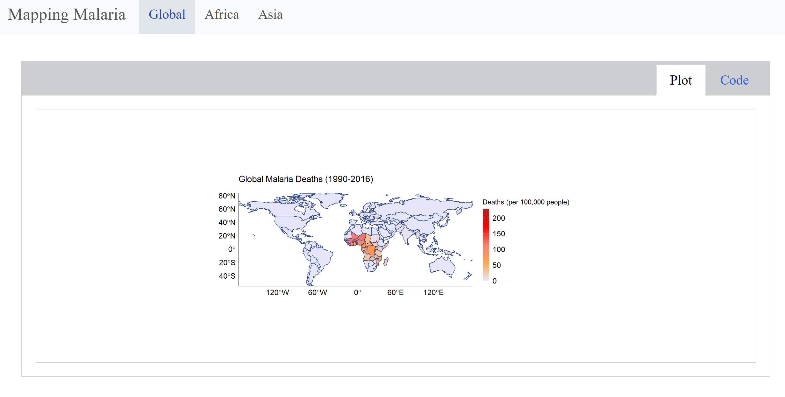

An animated geospatial dashboard tracking malaria mortality trends across global regions, highlighting changes in malaria death rates across Africa and Asia over time.

Built with R and Quarto using `gganimate` and custom color palettes to highlight regional mortality patterns.

[**View dashboard**](https://01a1b766-e9f6-df48-43a7-69649b98eaab.share.connect.posit.cloud/) · [**Code**](https://github.com/darakhshannehal/mapping-malaria-deaths)

