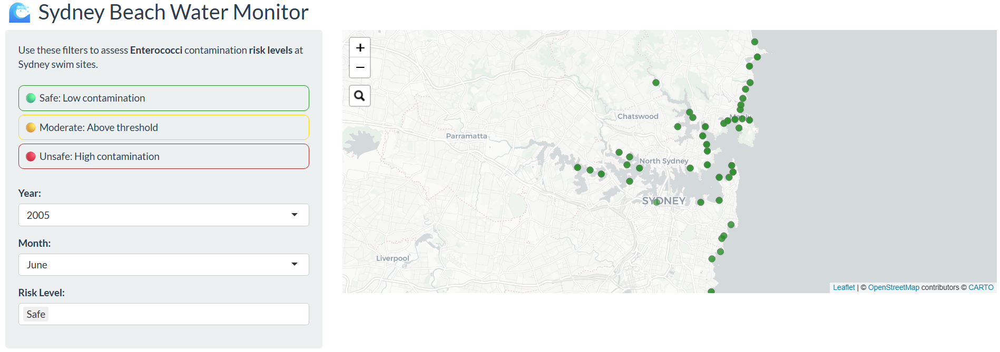

An interactive R Shiny and `leaflet` application assessing *Enterococci* bacterial contamination risk across Sydney swimming sites. Beyond recreational water monitoring, this spatial dashboard structure is adaptable to environmental hazard tracking and public health surveillance.

[**View app**](https://01a1b74d-24d4-ef6f-744c-bac7c17404ff.share.connect.posit.cloud/) · [**Code**](https://github.com/darakhshannehal/sydney-water-monitor)

------------------------------------------------------------------------
