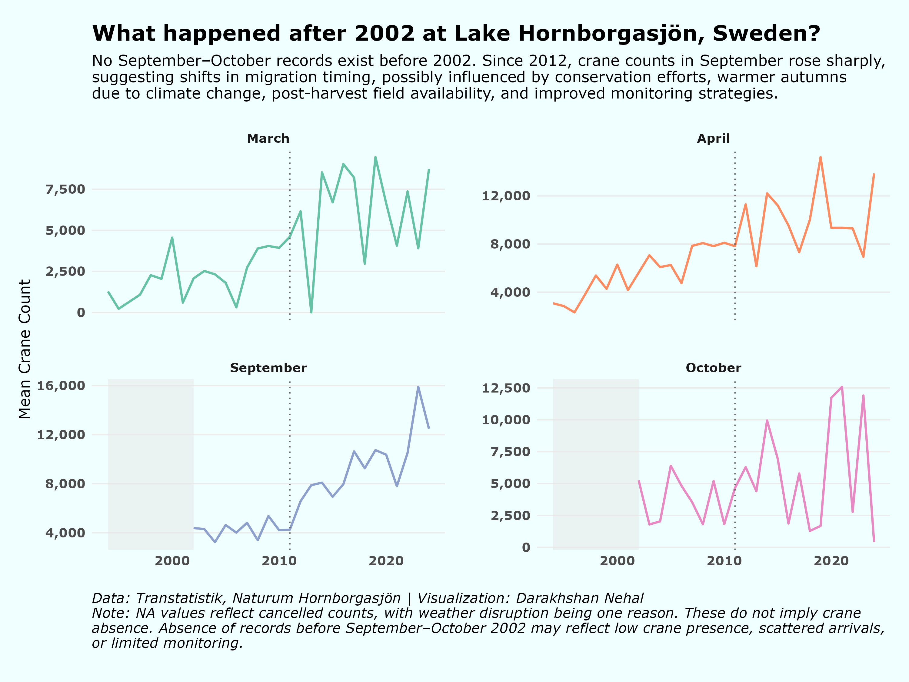
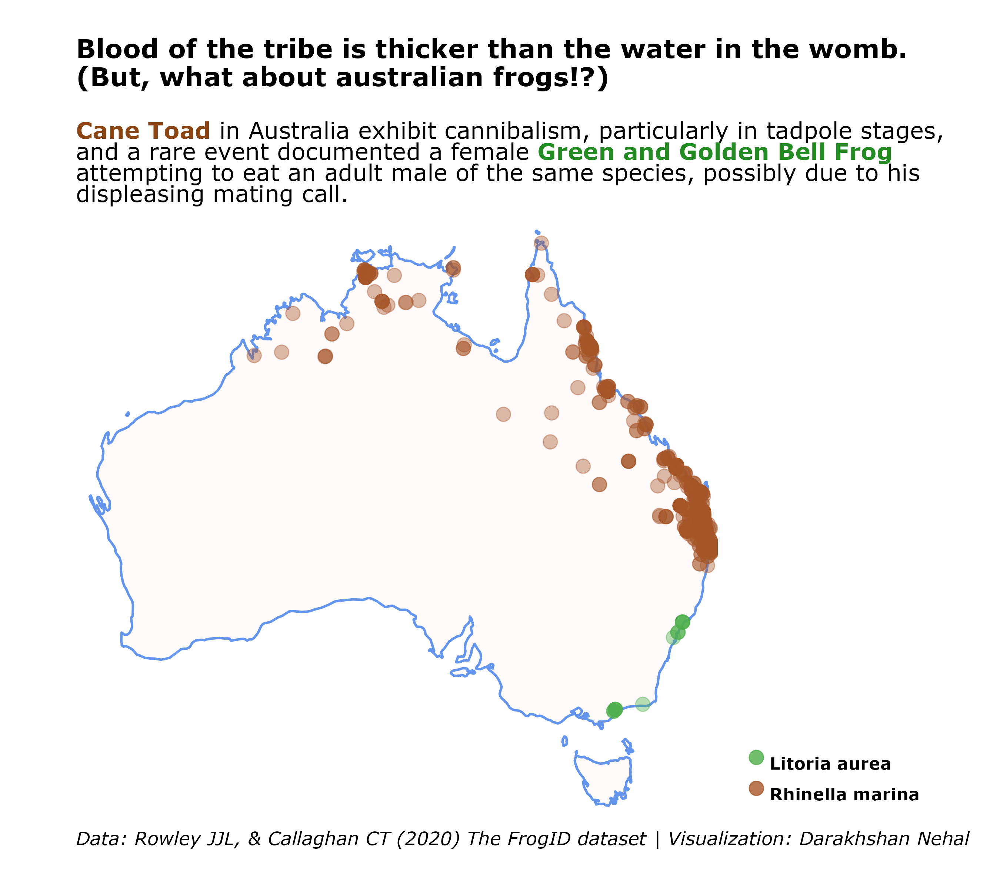
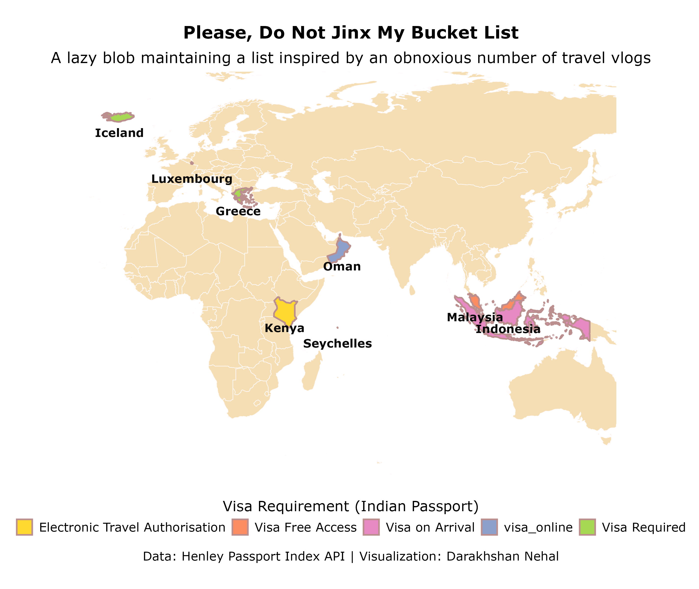
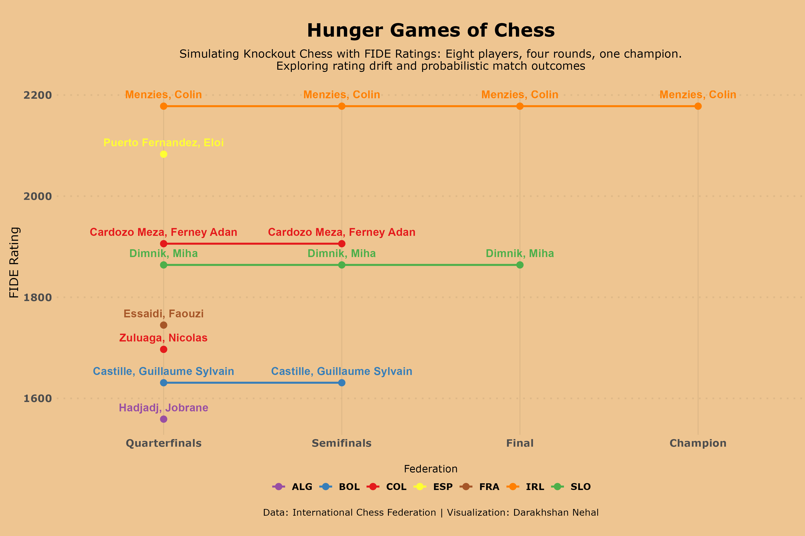
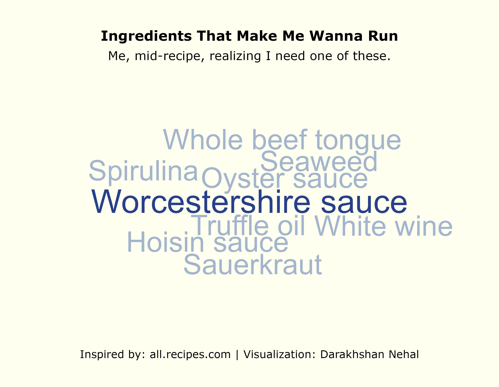

[Code and visualizations](https://github.com/darakhshannehal/TidyTuesday) created for **#TidyTuesday**, a weekly social data project organized by the [Data Science Learning Community](https://dslc.io/).

 *Seasonal crane count trends (1994–2024) at Lake Hornborgasjön, Sweden, highlighting shifts in autumn migration timing.*

------------------------------------------------------------------------

 *Spatial distribution of Cane Toads (`Rhinella marina`) and Green and Golden Bell Frogs (`Litoria aurea`) across Australia using FrogID occurrence records.*

------------------------------------------------------------------------

 *Travel bucket list mapped by Indian passport visa requirements using the Henley Passport Index API.*

------------------------------------------------------------------------

 *Knockout tournament simulation tracking FIDE rating progression across four rounds.*

------------------------------------------------------------------------

 *Word cloud of recipe ingredients from Allrecipes.*
