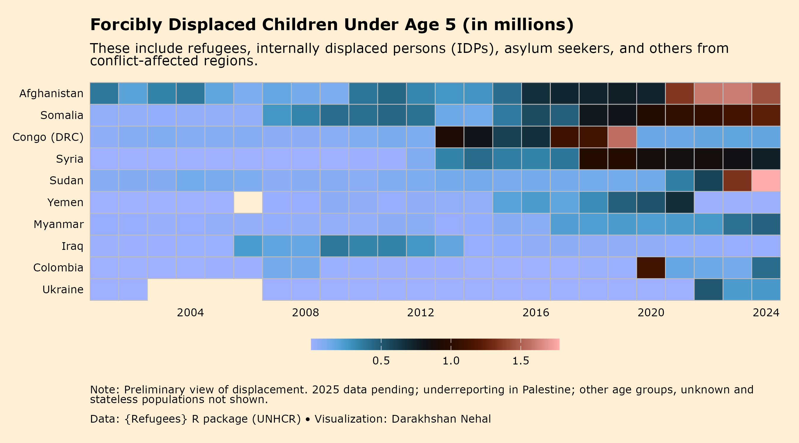
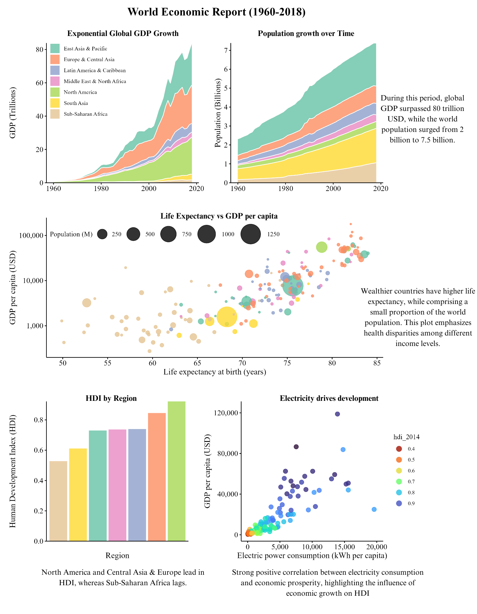

Selected data visualizations and multi-panel figures built with `ggplot2` in R.

 *Longitudinal heatmap of forcibly displaced children under age 5 across conflict-affected countries (2000–2024), using data from the UNHCR `{refugees}` R package.*

------------------------------------------------------------------------

